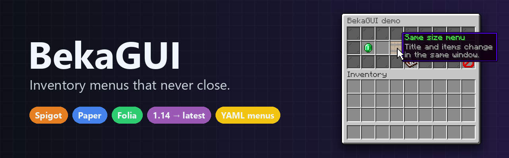
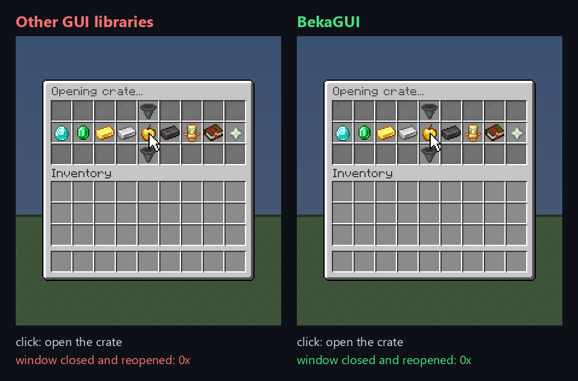
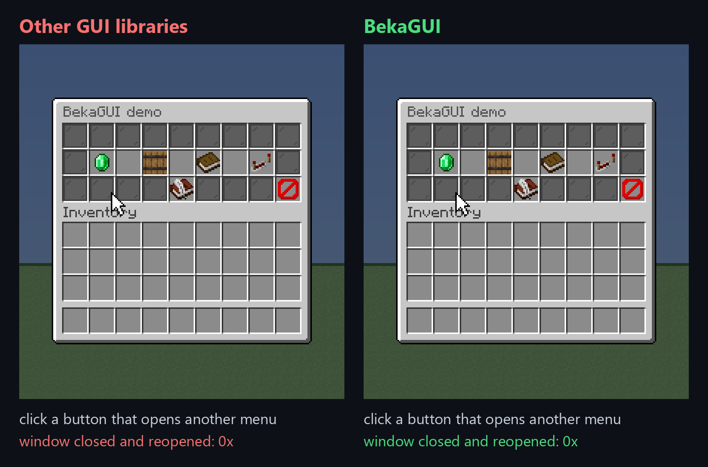
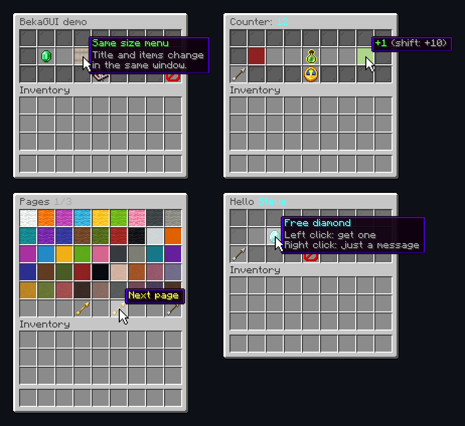
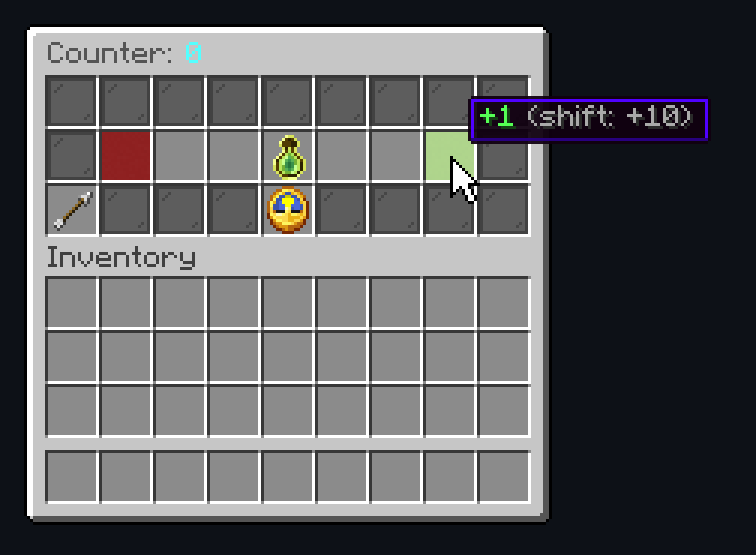
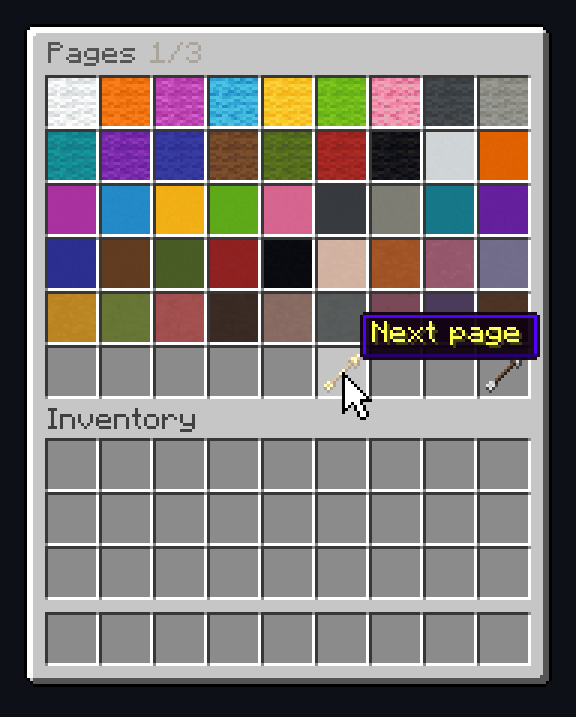
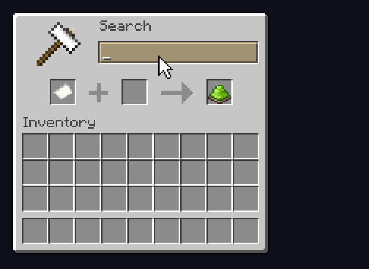
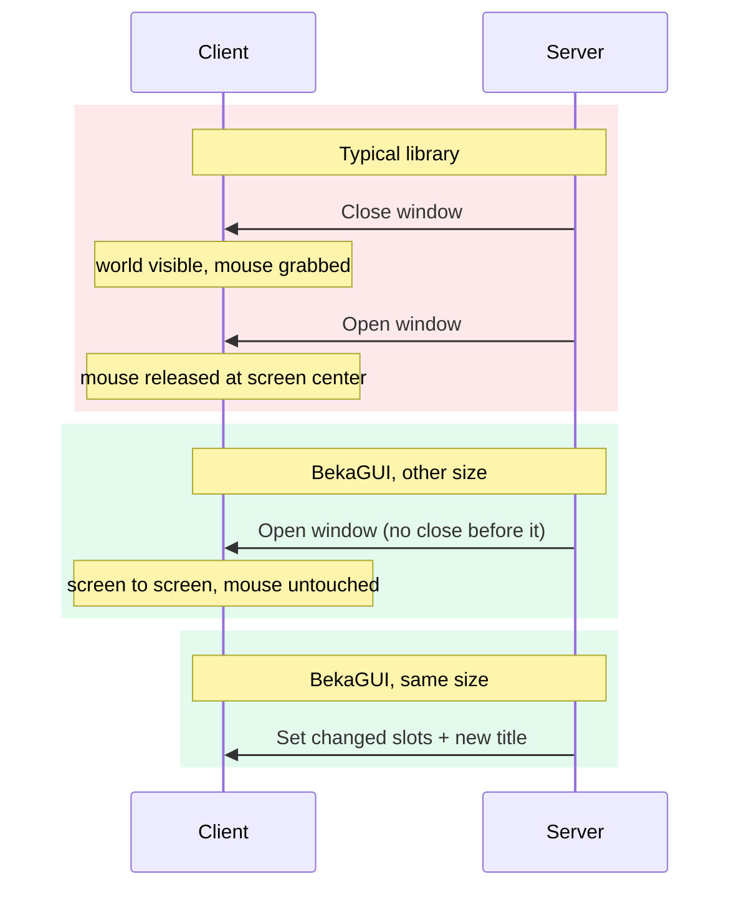

<p align="center">
  
</p>

<p align="center">
  <a href="https://jitpack.io/#bebeyat/BekaGUI"></a>
  <a href="https://github.com/bebeyat/BekaGUI/actions/workflows/build.yml"></a>
  
  
  
  <a href="LICENSE"></a>
</p>

**BekaGUI** is a small inventory GUI library for Spigot, Paper and Folia plugins with one rule:
**a menu never closes to show another menu.**

<p align="center">
  
</p>
<p align="center"><sub>A crate spin at normal game speed. Left: the window closes and reopens on every update. Right: BekaGUI, one window, the mouse never moves.</sub></p>

Most GUI libraries close the window and open a new one whenever a button leads to another menu. For a few
milliseconds the player sees the world (much longer on high ping), the mouse is thrown to the middle of the screen,
and players think they clicked something wrong. BekaGUI never does that.

| When you... | BekaGUI | The player sees |
|---|---|---|
| open a menu of the **same size** | changes only the slots that differ and the title, in the same window | just the new content |
| open a menu of **another size** | opens it over the current one, no close packet | an instant switch, the mouse stays put |
| ask for **text** (anvil) | opens the anvil over the menu, no close | an instant switch |
| call `update()` / auto refresh | re-renders and sends only the changed slots | live values, no flicker |

<p align="center">
  
</p>
<p align="center"><sub>Opening a menu of another size from a button.</sub></p>

## Features

- **Never closes to switch:** same-size diffing, in-place titles, window replacement without a close packet
- **Easy to write:** draw the menu with characters, bind keys to buttons, done
- **Dynamic menus:** `render`, per-player state, `update()`, auto refresh, live titles
- **Built in:** pagination, back history (with state), confirm dialogs, anvil text input
- **Safe:** items can never be moved into a menu, 100 ms click cooldown against double buys, errors in a button are logged instead of breaking the menu
- **No Java needed:** whole menus in YAML, with actions (`message`, `command`, `console`, `open`, `back`, `close`, `title`, `sound`, ...)
- **Everywhere:** Spigot, Paper, Folia, Minecraft 1.14 to the latest, one jar (Java 8 bytecode), no dependencies
- **AI-ready:** ships with a [skill file](skills/bekagui/SKILL.md) so coding assistants write correct BekaGUI code on the first try

## Installation

BekaGUI is a library. Add it to your plugin and **shade + relocate** it, so two plugins never share one copy.

<details open>
<summary><b>Maven</b></summary>

```xml
<repositories>
    <repository>
        <id>jitpack.io</id>
        <url>https://jitpack.io</url>
    </repository>
</repositories>

<dependencies>
    <dependency>
        <groupId>com.github.bebeyat.BekaGUI</groupId>
        <artifactId>bekagui-core</artifactId>
        <version>v1.0.0</version>
    </dependency>
</dependencies>
```

```xml
<plugin>
    <groupId>org.apache.maven.plugins</groupId>
    <artifactId>maven-shade-plugin</artifactId>
    <version>3.5.1</version>
    <executions>
        <execution>
            <phase>package</phase>
            <goals><goal>shade</goal></goals>
            <configuration>
                <relocations>
                    <relocation>
                        <pattern>dev.bekagui</pattern>
                        <shadedPattern>your.plugin.libs.bekagui</shadedPattern>
                    </relocation>
                </relocations>
            </configuration>
        </execution>
    </executions>
</plugin>
```
</details>

<details>
<summary><b>Gradle (Kotlin DSL)</b></summary>

```kotlin
repositories {
    maven("https://jitpack.io")
}

dependencies {
    implementation("com.github.bebeyat.BekaGUI:bekagui-core:v1.0.0")
}

tasks.shadowJar {
    relocate("dev.bekagui", "your.plugin.libs.bekagui")
}
```
</details>

Then, once in `onEnable`:

```java
BekaGUI.init(this);
```

On Folia, add `folia-supported: true` to your `plugin.yml`. That is all; threads are handled for you.

## Quick start

```java
Menu shop = Menu.builder()
        .title("&8Shop")
        .layout(                                   // 9 characters per row, '.' = empty
                "#########",
                "#..D.E..#",
                "####X####")
        .item('#', Item.of(Material.GRAY_STAINED_GLASS_PANE).name(" "))
        .button('D', Item.of(Material.DIAMOND).name("&bDiamond").lore("&7100 coins"),
                click -> buy(click.player(), "diamond"))
        .button('E', Item.of(Material.EMERALD).name("&aMore items"),
                click -> click.open(moreItems))    // switches menus, the window stays open
        .button('X', Item.of(Material.BARRIER).name("&cClose"), Click::close)
        .build();

shop.open(player);
```

Build a menu once and open it for as many players as you like. Each opening gets its own `View` with its own state.

<p align="center">
  
</p>

## Examples

### Dynamic content, state and live updates

<p align="center"></p>

```java
Menu counter = Menu.builder()
        .layout(
                "#########",
                "#-..N..+#",
                "#########")
        .item('#', Item.of(Material.BLACK_STAINED_GLASS_PANE).name(" "))
        .render(view -> {                          // runs on open and on every update()
            int n = view.get("n", 0);              // per-player state
            view.title("&8Counter: &b" + n);       // live title, same window
            view.set('N', Button.display(Item.of(Material.EXPERIENCE_BOTTLE).name("&b" + n)));
            view.set('+', Button.of(Item.of(Material.LIME_CONCRETE).name("&a+1"), click -> {
                click.view().put("n", n + 1);
                click.update();                    // only changed slots are sent
            }));
            view.set('-', Button.of(Item.of(Material.RED_CONCRETE).name("&c-1"), click -> {
                click.view().put("n", n - 1);
                click.update();
            }));
        })
        .refresh(20)                               // optional: re-render every second
        .build();
```

### Pages

<p align="center"></p>

```java
Menu list = Menu.builder()
        .layout(
                "xxxxxxxxx",
                "xxxxxxxxx",
                "xxxxxxxxx",
                "...p.n...")
        .render(view -> {
            view.paginate('x', allButtons);        // fills every 'x' with the current page
            view.title("&8Items " + (view.page() + 1) + "/" + view.pageCount());
            if (view.hasPrevious()) view.set('p', Button.of(Item.of(Material.ARROW).name("&ePrevious"), c -> c.view().previous()));
            if (view.hasNext())     view.set('n', Button.of(Item.of(Material.ARROW).name("&eNext"), c -> c.view().next()));
        })
        .build();
```

### Confirm dialog with back

`click.open(other)` remembers the current menu. `click.back()` returns to it **with its state** (page, selection).

```java
Menu confirm = Menu.builder()
        .title("&8Are you sure?")
        .layout(".........", "..Y...N..", ".........")
        .button('Y', Item.of(Material.LIME_WOOL).name("&aYes"), click -> { delete(click.player()); click.back(); })
        .button('N', Item.of(Material.RED_WOOL).name("&cNo"), Click::back)
        .build();
```

### Text input

<p align="center"></p>

```java
TextInput.create()
        .title("&8Search")
        .icon(Item.of(Material.PAPER).lore("&7Type a name"))
        .onSubmit((player, text) -> results(text).open(player))
        .onCancel(player -> main.open(player))     // ESC
        .open(player);
```

Opens over the current menu without closing it, and the menu stays in the back history. After a submit the
anvil stays open until you open something else, so invalid input can simply be ignored.
Needs Paper, or Spigot 1.21+.

### Everything a click can do

| Method | What it does |
|---|---|
| `click.player()`, `click.view()`, `click.slot()`, `click.type()` | who, where, how |
| `click.isLeft()`, `click.isRight()`, `click.isShift()` | click type |
| `click.open(menu)` | switch menu (no close) |
| `click.back()` | previous menu, with its state |
| `click.update()` | re-render this menu |
| `click.title("...")` | change the title |
| `click.close()` | really close |

### Menu options

| Builder method | What it does |
|---|---|
| `title(String)` / `titleComponent(Component)` | `&a`, `&l`, hex `&#FF8800`; Adventure components on Paper (custom-font texture titles) |
| `rows(int)` / `layout(String...)` | size; a layout sets the rows itself |
| `button(char, Item, handler)` / `item(char, Item)` | bind a layout key |
| `slot(int, Button)` | bind a raw slot (0 = top left) |
| `render(view -> ...)` | dynamic content |
| `refresh(ticks)` | re-render every N ticks while open |
| `onOpen(view -> ...)` / `onClose(view -> ...)` | `onClose` runs only on a real close, never on a menu switch |
| `lockPlayerInventory(true)` | also block clicks in the player's own inventory |

## Menus in YAML

For server owners who do not write Java. Every file in the folder is a menu; the file name is its id.

```java
YamlMenus menus = YamlMenus.load(this, new File(getDataFolder(), "menus"));
menus.open(player, "example");                    // menus/example.yml
```

```yaml
title: "&8Hello &b{player}"
layout:
  - "#########"
  - "#.A.B.C.#"
  - "<###X####"
items:
  "#": { material: GRAY_STAINED_GLASS_PANE, name: " " }
  A:
    material: DIAMOND
    name: "&bFree diamond"
    lore: ["&7Left click: get one", "&7Right click: just a message"]
    glow: true
    left-actions:
      - "console: give {player} diamond 1"
      - "sound: entity.experience_orb.pickup"
      - "message: &aHere you go, {player}!"
    right-actions:
      - "message: &7You right clicked."
  B: { material: NAME_TAG, name: "&eChange the title", actions: ["title: &6Changed without closing"] }
  C: { material: COMPASS, name: "&dShop", actions: ["open: shop"] }
  "<": { material: ARROW, name: "&7Back", actions: [back] }
  X: { material: BARRIER, name: "&cClose", actions: [close] }
```

| Item key | Meaning |
|---|---|
| `material` | Bukkit material name |
| `name`, `lore` | text with colors and `{player}` |
| `amount`, `model`, `glow` | stack size, CustomModelData, enchantment shine |
| `slot` / `slots` | slot numbers instead of a layout key |
| `actions`, `left-actions`, `right-actions` | what a click does |

| Action | What it does |
|---|---|
| `message: text` | chat message to the player |
| `command: cmd` | run as the player |
| `console: cmd` | run as the console |
| `open: id` | open another YAML menu (no close) |
| `back`, `close`, `refresh` | navigation |
| `title: text` | change the title in place |
| `sound: key` | e.g. `entity.experience_orb.pickup` |

Menu keys: `title`, `layout` or `rows`, `refresh`. A broken file is skipped and the reason is printed in the
console. PlaceholderAPI: `menus.placeholders(PlaceholderAPI::setPlaceholders)`.

## Using it with AI assistants

[`skills/bekagui/SKILL.md`](skills/bekagui/SKILL.md) explains the whole API, the common patterns, the rules that
prevent bugs and the error messages, in under 200 lines. Copy the folder into your assistant's skills directory
(for Claude Code: `.claude/skills/bekagui/`) and ask for a menu in plain words.

## How it works



- `Player#openInventory` closes the previous container **on the server only**; the client just receives the new
  screen. The client re-centers the mouse only when coming from the game world, so going screen to screen keeps it
  where it is.
- With the same size BekaGUI does not even open a new window: it diffs the slots and changes the title with
  `InventoryView#setTitle` (1.20+; older versions reopen without a close).
- `InventoryCloseEvent`s caused by switching are ignored, so `onClose` always means a real close.
- Folia: clicks already run on the player's region thread. `open()` from any other thread is moved there with the
  entity scheduler. Paper/Folia-only calls and `InventoryView` (an interface since 1.21) go through reflection, which
  keeps one jar working on every platform.

## Compatibility

| Platform | Menus | Component titles | Text input |
|---|---|---|---|
| Spigot 1.14 – 1.20 | ✅ | — | — |
| Spigot 1.21+ | ✅ | — | ✅ |
| Paper 1.16.5+ | ✅ | ✅ | ✅ |
| Folia and forks | ✅ | ✅ | ✅ |

Tested so far on Canvas 26.2 (a Folia fork), including a production server. The other rows follow from the APIs
used; reports from other versions are very welcome.

## Try the demo

`bekagui-demo` is a ready plugin. Build it, put `bekagui-demo/target/BekaGUI-Demo-1.0.0.jar` into `plugins/` (or
download it from the [releases](https://github.com/bebeyat/BekaGUI/releases)) and run `/bekagui`. It shows a
same-size switch, a size change, pages, a live counter with auto refresh and a YAML menu.

## Building

```
mvn package
```

JDK 17+ to build; the output runs on Java 8+. Tests run with `mvn test`.

## Contributing

Issues and pull requests are welcome. The one rule: nothing in a menu-switching path may close the window.
See [AGENTS.md](AGENTS.md) for the code layout.

## License

[MIT](LICENSE)
